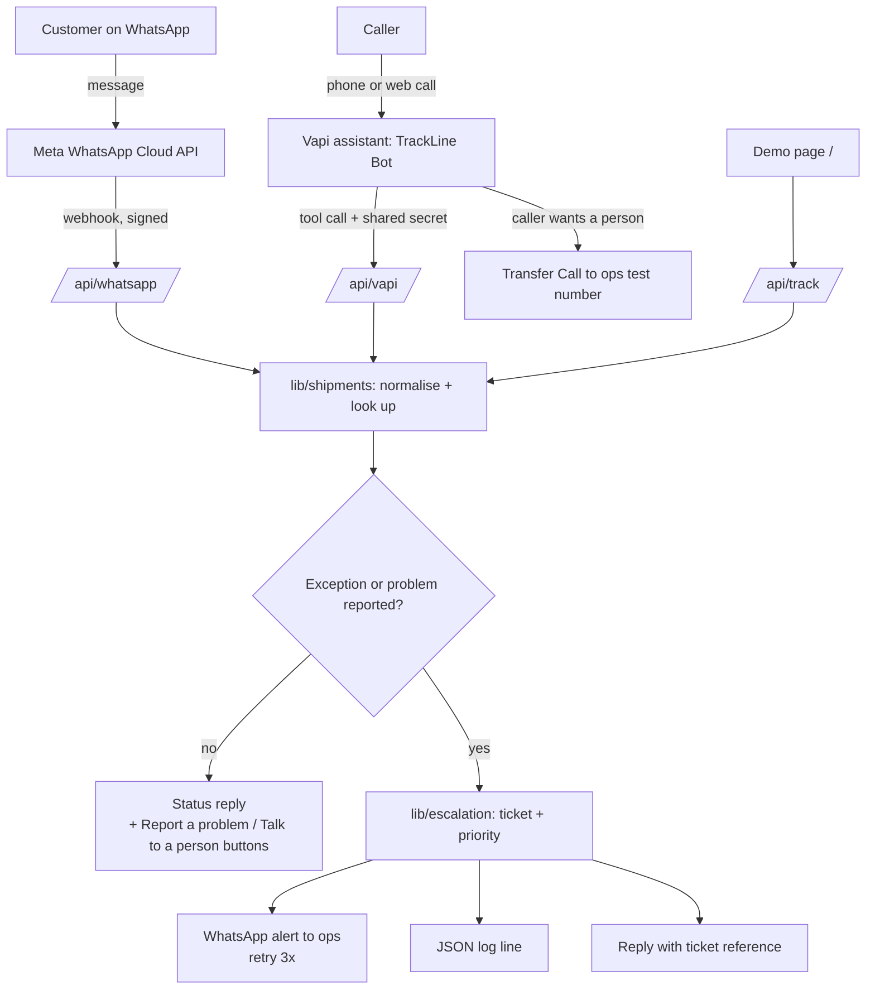

# TrackLine Bot · Delivery status on WhatsApp and voice

> 🎥 **Loom demo (60–90s):** _LOOM_LINK_HERE_
> 🌐 **Live demo:** _DEPLOYED_URL_HERE_

A delivery assistant for couriers. Customers send a tracking number on **WhatsApp** or say it on a **phone call**, and get the parcel's status straight away. When something has gone wrong (a long delay, repeated failed delivery attempts, a held or damaged parcel, or a customer reporting a problem), the bot **opens a support ticket and alerts the ops team on WhatsApp**. Voice callers can also be transferred to a person.

---

## Problem

"Where is my parcel?" is the most common call a courier's support line gets. Most of those calls only need a status lookup, but they queue with the real problems (damaged, lost, wrong address), so the customers who most need help wait longest. Customers in Nigeria also expect to do this on WhatsApp, not through a web form.

## Who it's for

- Logistics companies, last-mile couriers and dispatch riders with a tracking system
- E-commerce merchants who handle their own deliveries
- Agencies that build support automation for logistics clients

## Features

- **Tracking lookup:** it accepts numbers typed any way (`tl-2048 1736`) or spoken ("tee el two zero four eight one seven three six", "double three"). Answers give status, city, last scan and ETA in plain language.
- **WhatsApp + voice:** one Node.js backend serves both. WhatsApp uses the Cloud API with reply buttons and a problem list. Voice uses a Vapi assistant with `lookup_shipment`, `report_problem`, transfer to a person and end call.
- **Exception escalation:**
  - *Automatic*: a lookup on a shipment with no scan for 48h+, 2 failed attempts, held at a hub, or damaged opens a ticket without the customer asking.
  - *Customer-reported*: damaged, delivered but not received, wrong item, late, reschedule, or "talk to a person", in free text, buttons or voice.
  - Tickets get a priority (high for damage/loss, or any parcel worth ₦100k+) and a deterministic reference such as `ESC-20261116-67C7`, so a retry never opens a duplicate.
  - The ops team gets a WhatsApp alert with the ticket. Every escalation is also logged as a JSON line.
- **Privacy by design:** anyone with a tracking number can ask, so answers only ever include status and city, never names, phone numbers or street addresses. Customer numbers in ops alerts and logs are masked (`+•••••••0101`).
- **Stateless conversations:** button and list IDs carry the tracking number, so there's no session store and it runs on serverless hosting.

## Stack

| Layer | Tool |
|---|---|
| Backend | Node.js 20+ (no framework, no dependencies), Web-standard handlers |
| Hosting | Vercel serverless functions + static demo page |
| WhatsApp | Meta WhatsApp Cloud API (`/api/whatsapp`) **or** the Twilio WhatsApp sandbox (`/api/twilio-whatsapp`), same conversation logic |
| Voice | Vapi (function tools, Transfer Call, End Call, end-of-call reports) |
| Tests | Node's built-in test runner |

## Architecture



| Endpoint | Purpose |
|---|---|
| `GET /api/whatsapp` | Meta webhook verification (`hub.verify_token`) |
| `POST /api/whatsapp` | Inbound WhatsApp messages (checks `X-Hub-Signature-256`) |
| `POST /api/vapi` | Vapi tool calls and end-of-call reports (checks `X-Vapi-Secret`) |
| `POST /api/twilio-whatsapp` | Same bot over Twilio's WhatsApp sandbox (TwiML replies, checks `X-Twilio-Signature`) |
| `GET /api/track?id=` | Public demo lookup for the web page |
| `GET /api/health` | Shows which integrations are configured (no secrets) |

### Demo shipments (fictional)

| Tracking | Status | What happens |
|---|---|---|
| TL20481736 | In transit | Status + buttons |
| TL20481737 | Out for delivery | Status + buttons |
| TL20481738 | Delivered | Try "never got it" → high-priority ticket |
| TL20481739 | Delayed, no scan for 60h | **Auto-escalates** |
| TL20481740 | 2 failed attempts | **Auto-escalates** |
| TL20481741 | Held at hub, ₦250k parcel | **Auto-escalates, high priority** |
| TL20481742 | Damaged | **Auto-escalates** |
| TL20481743 | Label created | Status + buttons |

## Tools used (free tiers)

| Brief says | Used here | Why |
|---|---|---|
| WhatsApp Cloud API | Built and tested (`/api/whatsapp`) **and** a Twilio WhatsApp sandbox route (`/api/twilio-whatsapp`) | Meta blocked developer registration on a new device ("you're using a device you don't usually use"). The sandbox runs the identical conversation logic. Without reply buttons, the menus become text such as "TL20481736 damaged". Switching back to Meta only needs the env vars and the webhook URL; no code changes. |
| Vapi | Vapi (trial credit) | Voice assistant with function tools and transfer |
| Node.js | Node.js 20+ on Vercel (Hobby, free) | Deployed demo + webhooks |

## Setup

1. **Test locally**
   ```bash
   npm test            # 18 tests
   npm run dev         # http://localhost:3000, same handlers as Vercel
   ```
2. **Meta WhatsApp:** at developers.facebook.com, create an app (Business type) and add **WhatsApp**.
   - Under **API Setup**, note the *Phone number ID*, and add your own WhatsApp number as a test recipient.
   - Create a permanent token: a System User in Business settings, with `whatsapp_business_messaging` permission. The temporary token lasts 24 hours.
3. **Deploy to Vercel:** import this repo with no build settings needed, and add the variables from [`.env.example`](.env.example) (`WHATSAPP_*`, `OPS_WHATSAPP_NUMBER`, `VAPI_SHARED_SECRET`, `TIMEZONE`).
4. **Webhook (Twilio alternative):** in Twilio Console, go to **Messaging → Try it out → Send a WhatsApp message → Sandbox settings**. Set *When a message comes in* to `https://<your-app>.vercel.app/api/twilio-whatsapp` (POST), and set `TWILIO_*` and `PUBLIC_BASE_URL` in Vercel. Each tester joins the sandbox by sending `join <code>` to +1 415 523 8886.
5. **Webhook (Meta):** in Meta, go to **WhatsApp → Configuration → Webhook**. Set the callback URL to `https://<your-app>.vercel.app/api/whatsapp`, use your `WHATSAPP_VERIFY_TOKEN`, and subscribe to **messages**.
6. **Vapi:** fill `.env` (`VAPI_API_KEY`, `VAPI_SERVER_URL=https://<your-app>.vercel.app/api/vapi`, `VAPI_SHARED_SECRET`, `OPS_PHONE_NUMBER`), then run:
   ```bash
   node scripts/setup-vapi.js --dry-run && node scripts/setup-vapi.js
   ```
   Test with **Talk to Assistant** in the Vapi dashboard, or attach a phone number.

## Error handling

| Case | Behaviour |
|---|---|
| Tracking number typed or heard badly | Normalised (spaces, dashes, number words, "double/triple", "tee el"). If still invalid, the bot asks again with the format |
| Unknown tracking number | Clear "couldn't find TL…" reply; voice reads back what it heard |
| WhatsApp API 429 / 5xx / network error | Up to 3 attempts with exponential backoff |
| WhatsApp API 4xx | Not retried (won't fix itself); logged |
| Interactive message rejected | Falls back to a plain-text version with typed commands |
| Meta retries the same webhook | Duplicate message IDs ignored; ticket IDs are deterministic, so no duplicate tickets |
| Bad or missing webhook signature | HTTP 401 when `WHATSAPP_APP_SECRET` is set |
| Handler error | Logged; still returns 200 to Meta to avoid retry storms |
| Images, voice notes, stickers | "I can only read text" reply |
| Problem reported without a tracking number | Asks for the number with the problem |
| Vapi request without the secret | HTTP 401 |
| Vapi tool error / bad arguments / unknown tool | `error` field with HTTP 200 (as Vapi requires); the assistant offers a transfer |
| Ops alert can't be delivered | Ticket still logged and the customer still gets their reference; failure logged |

**WhatsApp 24-hour rule:** Meta only allows free-form messages to a number that has messaged the business in the last 24 hours. For ops alerts on the free test number, the ops phone should send any message to the bot once a day. In production, use an approved message template for alerts.

## Data, privacy and safety

- **Seed data only:** every shipment in `lib/shipments.js` and `sample-data/` is fictional. Sample customers use the +1 555-0100 range, which is reserved for fiction.
- **Opted-in contacts only:** the bot only replies to people who message it first. Ops alerts and voice transfers go to the developer's own test number, which is registered as a test recipient in Meta.
- **Minimal disclosure:** lookups return status and city only. Numbers are masked in alerts and logs.
- **No secrets committed:** `.env` is git-ignored, and secrets live in Vercel and Vapi.

## Screenshots

_Added after the recorded run:_ `docs/screenshots/`

## Testing

- `npm test`: 18 tests covering tracking-number parsing (typed and spoken), lookups, privacy of status text, issue detection, auto-escalation rules, ticket IDs and priority, the WhatsApp conversation (buttons, lists, fallbacks), the signature check, send retries, Vapi tools, and the HTTP routes (verify handshake, dedupe, auth, demo lookup)
- [`docs/TEST_CHECKLIST.md`](docs/TEST_CHECKLIST.md): manual WhatsApp and voice checks

## Repo structure

```
api/whatsapp.js         WhatsApp webhook (verify + messages)
api/vapi.js             Vapi tool calls + end-of-call reports
api/track.js            public demo lookup
api/health.js           configuration check
lib/shipments.js        demo data, tracking-number normalisation, status text
lib/escalation.js       issue detection, auto-escalation rules, tickets, alerts
lib/whatsapp.js         webhook parsing, signature, conversation logic, sending
lib/vapi.js             voice tool handlers
lib/notify.js           ticket logging + ops WhatsApp alert
public/index.html       demo page
vapi/                   assistant, system prompt, tools (generated)
scripts/                dev server, Vapi config builder + setup
sample-data/            fictional webhook payloads and shipments
tests/                  automated tests
```
