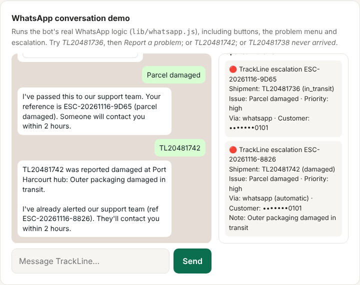

# Recorded run: 16 Nov 2026

**Deployment:** https://taw-ind-trackline-bot.vercel.app (Vercel, production)

## 1. Smoke tests against production (from `scripts/setup-mac.sh`)

| Check | Result |
|---|---|
| `GET /api/health` | `{"ok":true,"whatsapp_configured":false,"twilio_configured":true,"ops_alerts_configured":true,"vapi_secret_set":true}` |
| `GET /api/track?id=TL20481741` | `held_at_hub`, `exception: true`, `escalates: true` |
| Meta verify handshake `GET /api/whatsapp?hub.mode=subscribe…&hub.challenge=OK123` | `OK123` |
| Vapi tool call `POST /api/vapi` (`lookup_shipment`, spoken "T L two zero four eight one seven four one") | found, `held_at_hub`, auto-ticket `ESC-…` |
| Vapi assistant + 4 tools created with `scripts/setup-vapi.js` | ✅ |

## 2. Real WhatsApp messages reach the bot

The tester's phone (+234 701 ••• 9553, opted in by joining the Twilio trial) sent `TL20481736` to the Twilio WhatsApp trial number (+1 737 250 8034), whose inbound webhook was set to `/api/twilio-whatsapp`. Vercel runtime logs:

```
15:21:16  {"event":"twilio_whatsapp_message","replies":1,"tickets":[]}
15:22:43  {"event":"twilio_whatsapp_message","replies":1,"tickets":[]}
15:23:34  {"event":"twilio_whatsapp_message","replies":1,"tickets":[]}
15:25:02  {"event":"twilio_whatsapp_message","replies":1,"tickets":[]}
```

A signed request replaying the same payload returned **HTTP 200** with the TwiML reply:

```xml
<Response><Message>TL20481736 is on its way from Lagos to Abuja. Last scan: Ibadan sorting hub, Mon 10:25 am. Expected delivery: Tuesday 17 November.

Reply "TL20481736 problem" to report an issue, or "TL20481736 agent" to talk to a person.</Message></Response>
```

**Known limitation:** Twilio's free trial WhatsApp sender only delivers Twilio's own pre-approved templates, so it silently dropped the bot's custom-text replies (the same limit hit in P1). Meta developer registration was blocked on the device ("a device you don't usually use"). Delivering replies needs either an upgraded Twilio account (no code change) or a Meta Cloud API app (set the `WHATSAPP_*` env vars and point the Meta webhook at `/api/whatsapp`). The full conversation is shown with the same code in the demo chat on the live page.

## 3. Conversation demo (same logic, live page)



`TL20481736` → status + buttons → **Report a problem** → **Parcel damaged** → ticket `ESC-…-9D65` (high priority). `TL20481742` → **automatic** escalation (damaged) → ticket `ESC-…-8826`. Both ops alerts are shown with the customer's number masked.

## 4. Automated tests

`npm test`: 19/19 pass.
